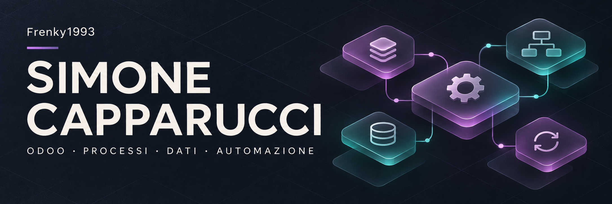

  

  
  
  
  

  <strong>Processi chiari. Automazioni utili. Dati di cui fidarsi.</strong>

---

## Ciao, sono Simone 👋

Mi occupo di trasformare esigenze operative in processi più chiari, strumenti utili e informazioni verificabili.

Il mio lavoro si concentra sul collegamento tra **persone, attività aziendali e sistemi**, con particolare attenzione a Odoo, alla qualità dei dati e all’automazione delle attività ripetitive.

## 💼 Di cosa mi occupo

<table>
  <tr>
    <td width="50%" valign="top">
      <h3>🧩 Odoo e processi aziendali</h3>
      
Analisi delle esigenze, definizione dei flussi e documentazione funzionale.

    </td>
    <td width="50%" valign="top">
      <h3>📊 Dati e controllo operativo</h3>
      
Riconciliazioni, verifiche di coerenza, report e indicatori a supporto delle decisioni.

    </td>
  </tr>
  <tr>
    <td width="50%" valign="top">
      <h3>⚙️ Automazione e AI applicata</h3>
      
Strumenti per semplificare il lavoro quotidiano, con controlli e risultati verificabili.

    </td>
    <td width="50%" valign="top">
      <h3>✅ Test e rilascio</h3>
      
Criteri di accettazione, validazione delle modifiche e documentazione per gli utenti.

    </td>
  </tr>
</table>

## 🛠 Ambiti di lavoro

| Ambito | Attività |
| :--- | :--- |
| **ERP e integrazioni** | Odoo, flussi operativi, importazioni e collegamenti tra sistemi. |
| **Analisi e reporting** | Excel, dashboard, KPI e qualità dei dati. |
| **Organizzazione degli sviluppi** | Raccolta delle richieste, specifiche funzionali, test e tracciamento delle attività. |

## 📈 Attività su GitHub

  

  Statistiche dell’attività pubblica su GitHub.

  
<strong>🔎 Cosa trovi nel mio lavoro</strong>

Mi interessano i progetti che risolvono problemi concreti: rendere un processo comprensibile, individuare un’incongruenza nei dati, ridurre un’attività manuale o rendere più semplice un controllo.

Parto dal problema operativo, chiarisco il risultato atteso e verifico che la soluzione funzioni nel contesto in cui verrà utilizzata.

---

  
   
  <em>I am a Dragon</em>

